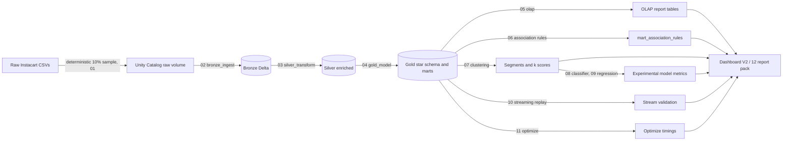
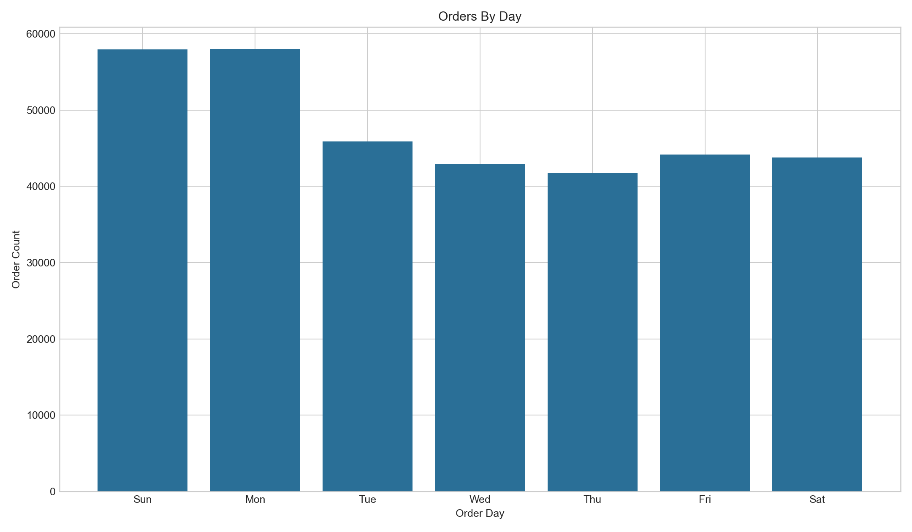
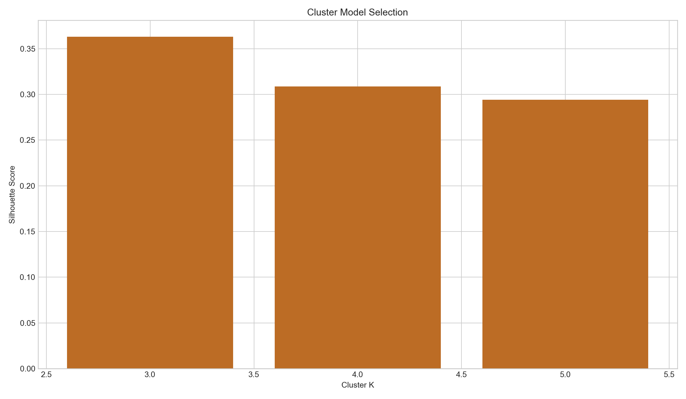
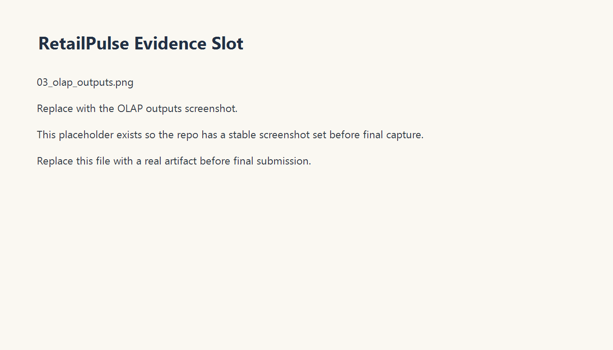
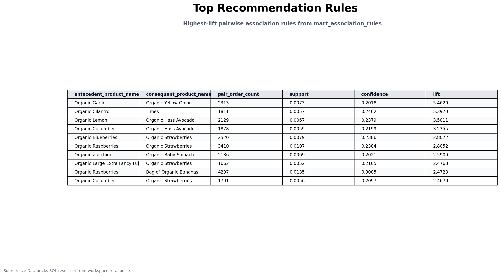
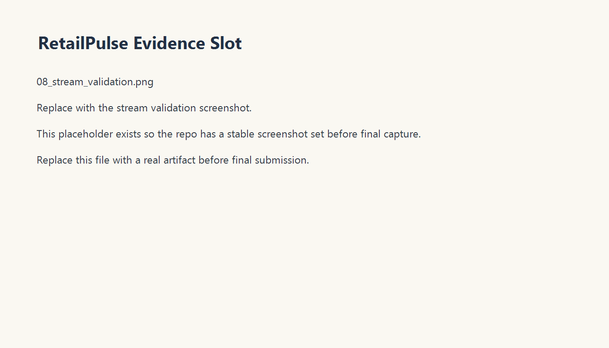
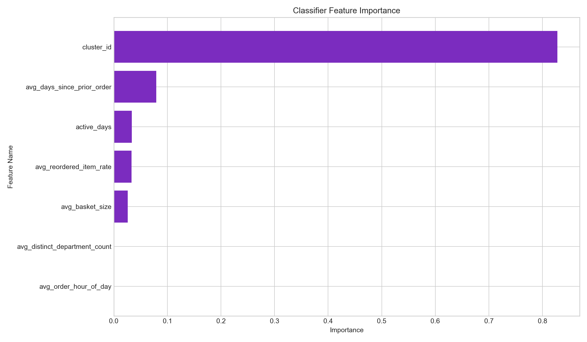

# RetailPulse

<p align="center">
  
</p>

<p align="center"><strong>Retail analytics, recommendation, and dashboarding on Databricks.</strong></p>

<p align="center">
  
  
  <a href="https://the-harsh-vardhan.github.io/RetailPulse/"></a>
  <a href="RESULTS-README.md"></a>
  <a href="HOW%20TO%20USE.md"></a>
</p>

RetailPulse is a Databricks-first retail analytics lakehouse built around a validated Instacart implementation. It takes grocery order history through a bronze, silver, and gold Delta pipeline, persists OLAP and report tables, surfaces cross-sell recommendations and customer segments, validates a replay-style streaming flow, and publishes a five-page AI/BI dashboard.

## What it does

- Samples the Instacart dataset deterministically (10% of users) and deploys the pipeline as a Databricks Asset Bundle job.
- Builds bronze, silver, and gold Delta tables, including a star schema (see [star schema diagram](assets/retailpulse_star_schema.mmd)).
- Produces OLAP `CUBE`/`ROLLUP` report tables, association-rule recommendations, and KMeans shopper segments.
- Validates a replay-style streaming aggregation (`Trigger.AvailableNow`) against the equivalent batch result.
- Publishes a five-page Databricks AI/BI dashboard, with a notebook fallback (`notebooks/12_report_pack.py`).

## Architecture

The diagram mirrors the task graph in `resources/*.yml` (job `retailpulse_full_rebuild`).



Sources: [retailpulse_medallion.mmd](assets/retailpulse_medallion.mmd), [retailpulse_star_schema.mmd](assets/retailpulse_star_schema.mmd). Notebooks `13_predictive_analysis.py` and `14_prescriptive_analysis.py` are supplementary walkthroughs outside the job.

## Results

From the validated Databricks Free Edition serverless run (5 April 2026, job `61936309152043`, run `631388168060027`). Full tables in [RESULTS-README.md](RESULTS-README.md).

| Area | Result |
| --- | --- |
| Sample size | 341,974 orders, 3,267,191 prior and 137,847 train order lines |
| Gold facts | `fact_order_items` 3,405,038 rows, `fact_orders` 334,438 rows |
| Top department | Produce, 989,427 items (Dairy eggs 564,570 second) |
| Strongest named rule | Organic Garlic -> Organic Yellow Onion, lift 5.46 (49 rules persisted) |
| Shopper segments | 3 KMeans clusters (6,440 / 9,050 / 5,130 users) |
| Streaming check | 158 order-slot groups, 0 mismatches vs batch aggregation |
| Exploratory models | Decision tree accuracy 0.9136 (majority baseline 0.7445); linear regression R2 0.5580, RMSE 5.0945 (mean baseline 7.6627) |
| OPTIMIZE / ZORDER | Completed, but no speedup on this small sample (ratios 0.84 and 0.70) |

The supervised models are exploratory, not release gates.

## Screenshots

| Orders by day | Cluster model selection (silhouette, k = 3, 4, 5) |
| --- | --- |
|  |  |

| Executive overview and OLAP outputs | Recommendation proof |
| --- | --- |
|  |  |

| Streaming validation | Classifier feature importance |
| --- | --- |
|  |  |

Full evidence set: [RESULTS-README.md](RESULTS-README.md) and [docs/evidence-pack.md](docs/evidence-pack.md).

## Quickstart

Requires Git, Python 3.11+, and Databricks CLI 0.205.x+. Download the six raw Instacart CSVs first. Full guide: [HOW TO USE.md](HOW%20TO%20USE.md).

```bash
git clone https://github.com/The-Harsh-Vardhan/RetailPulse.git && cd RetailPulse
python scripts/sample_instacart.py --input-dir /path/to/instacart_raw --output-dir /path/to/retailpulse_sample
python -m unittest -q tests.test_sample_instacart tests.test_split_stream_replay_batches tests.test_export_databricks_source_to_ipynb
databricks auth login --host https://<your-workspace-host>
databricks bundle validate -t dev
databricks bundle deploy -t dev
# upload the sampled CSVs to /Volumes/<catalog>/<schema>/<raw_volume>/ (manual step)
databricks bundle run retailpulse_full_rebuild -t dev
```

## Project structure

```text
notebooks/      00_setup .. 12_report_pack (job tasks), 13/14 supplementary analysis
resources/      Databricks job definition (retailpulse_full_rebuild)
databricks.yml  bundle config (dev target)
scripts/        sampling, replay-batch split, notebook export
sql/            dashboard queries, release smoke checks
tests/          unit tests for the scripts
assets/         logo, screenshots, Mermaid sources
docs/           handbook, runbook, evidence pack, submission material
docs/           GitHub Pages site
```

## Tech stack

Databricks (Asset Bundles, serverless, Unity Catalog volumes, AI/BI dashboards), Delta Lake, PySpark and Spark ML (KMeans, decision tree, linear regression), Spark Structured Streaming, SQL, Python 3.11, GitHub Actions.

## Docs

Docs site: https://the-harsh-vardhan.github.io/RetailPulse/. Repository docs: [CONTRIBUTING.md](CONTRIBUTING.md), [CODE_OF_CONDUCT.md](CODE_OF_CONDUCT.md), [SECURITY.md](SECURITY.md). Report and paper sources live in [docs/Submission](docs/Submission).

## Status

### Implemented now
- Deterministic 10% Instacart sampling flow, Databricks Asset Bundle deployment and sequential rebuild job
- Star schema, OLAP report tables, association rules, clustering, streaming validation, and optimize evidence
- Dashboard V2 with five reviewer-facing pages (`RetailPulse Demo Dashboard`, id `01f1305e8f1a115e8fb2b378bd4d8f99`, revision `2026-04-05T08:40:02.619Z`)
- Notebook fallback via `notebooks/12_report_pack.py` and supplementary predictive and prescriptive notebooks

### Planned next
- Self-service dataset upload and mapping flow for non-Instacart retail datasets
- Dataset-aware multi-store operation behind a canonical retail contract
- Optional external BI layer after the Databricks story is fully stable

## From Idea To Implementation

RetailPulse started as a 2-week Databricks warehouse project idea: take a public retail-like dataset, prove a proper medallion pipeline, build analytics tables that are actually reviewable, and package the work so it survives beyond a notebook demo. The project then evolved through four stages:

1. `Foundation`: deterministic sampling, Databricks bundle deployment, bronze-silver-gold pipeline, and star schema.
2. `Analytics`: OLAP outputs, pairwise association-rule mining, clustering, replay-style streaming validation, and optimization evidence.
3. `Presentation`: screenshot pack, report-pack notebook, published Databricks AI/BI dashboard, and GitHub-facing docs.
4. `Release hardening`: release checklist, production-state docs, smoke checks, boss-facing walkthrough, and Dashboard V2 polish.

The result is a repo that is not just “some notebooks,” but a packaged analytics system with a validated live run and a reviewable evidence trail.

## Open These First

If you are reviewing the repo on GitHub, use this order:

1. [RESULTS-README.md](RESULTS-README.md)
2. [HOW TO USE.md](HOW%20TO%20USE.md)
3. [docs/showcase-summary.md](docs/showcase-summary.md)
4. [docs/RetailPulse Handbook.md](docs/RetailPulse%20Handbook.md)
5. [docs/current-production-state.md](docs/current-production-state.md)

## Dashboard V2 Story

The live Databricks dashboard is organized into five pages:

1. `Executive Overview`
2. `Order Behavior`
3. `Recommendations And Segments`
4. `Execution And Data Quality`
5. `Experimental Insights And Performance`

That same page order is mirrored in the packaged evidence and the fallback notebook.

For deeper walkthroughs after the five-page story, use `notebooks/13_predictive_analysis.py` for the exploratory predictive lane, `notebooks/14_prescriptive_analysis.py` for the action-oriented recommendation and segmentation lane, and `docs/dashboard-output-diagrams.md` for the widget-by-widget dashboard explanation.

## Current Vs Future

### Current repo truth
- The repo contains a validated Instacart implementation on Databricks.
- The live dashboard, screenshot pack, and report-pack notebook are all real and aligned.
- Classifier and regression outputs remain in an `Experimental Insights` lane.

### Future system goal
- A self-service upload and mapping system where a retailer can provide order-item CSVs and RetailPulse can normalize them, analyze them, publish a dashboard, and produce actionable output files.

That future system is planned next. It is not already implemented in this repository.

## Explore Further

### Project story and results
- [RESULTS-README.md](RESULTS-README.md)
- [docs/showcase-summary.md](docs/showcase-summary.md)
- [docs/dashboard-output-diagrams.md](docs/dashboard-output-diagrams.md)
- [docs/boss-brief.md](docs/boss-brief.md)

### Running and adapting the workflow
- [HOW TO USE.md](HOW%20TO%20USE.md)
- [docs/RetailPulse Handbook.md](docs/RetailPulse%20Handbook.md)
- [docs/rebuild-from-scratch.md](docs/rebuild-from-scratch.md)

### Live-state and release docs
- [docs/current-production-state.md](docs/current-production-state.md)
- [docs/production-runbook.md](docs/production-runbook.md)
- [docs/release-checklist.md](docs/release-checklist.md)
- [sql/release_smoke_checks.sql](sql/release_smoke_checks.sql)

## Honesty Rules

- RetailPulse currently proves a validated Instacart analytics implementation, not a generic upload-any-retail-CSV product.
- Dashboard V2 is implemented and validated now.
- The generic self-service uploader and mapper are planned next.
- The supervised ML outputs are exploratory and are not operational decision drivers in the current release.

