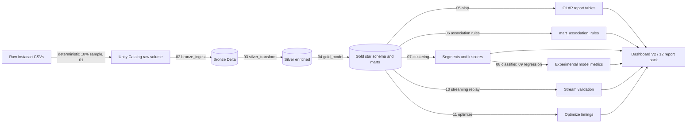
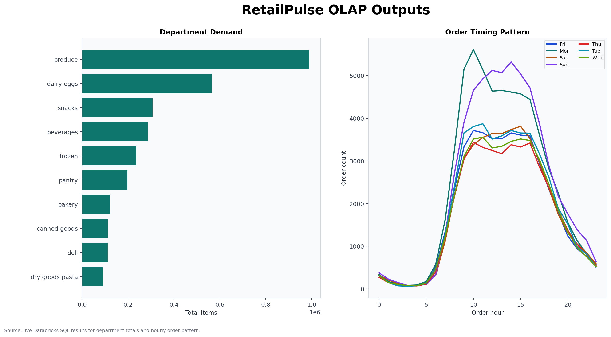

# Architecture

The pipeline is the Databricks job `retailpulse_full_rebuild`, defined in `resources/*.yml` and deployed through the Asset Bundle in `databricks.yml`. Tasks run in this order:

(GitHub renders this diagram in the repository README; here it is shown as source.)

## Components

- **00 setup, 01 sample and upload**: creates schema and volumes; a local script builds the deterministic 10% user sample, which is uploaded manually to the raw volume.
- **02 bronze, 03 silver, 04 gold**: raw CSV to Delta tables, then enriched order, item, product and user-history tables, then the star schema and marts (`fact_order_items`, `fact_orders`, `mart_user_features`).
- **05 OLAP**: `CUBE`, `ROLLUP` and basket-size report tables plus a validation table comparing cube totals to direct totals.
- **06 association rules**: serverless-safe pairwise rule mining (not FP-growth) into `mart_association_rules` with support, confidence, and lift.
- **07 clustering**: KMeans for k = 3, 4, 5, best silhouette chosen, labels written to `mart_user_features`.
- **08 classifier, 09 regression**: exploratory decision tree and linear regression, kept in an Experimental Insights lane.
- **10 streaming replay**: held-out orders written as replay batches, aggregated with `Trigger.AvailableNow`, compared to the batch aggregation.
- **11 optimize, 12 report pack**: `OPTIMIZE`/`ZORDER` benchmark; notebook fallback for the dashboard.

