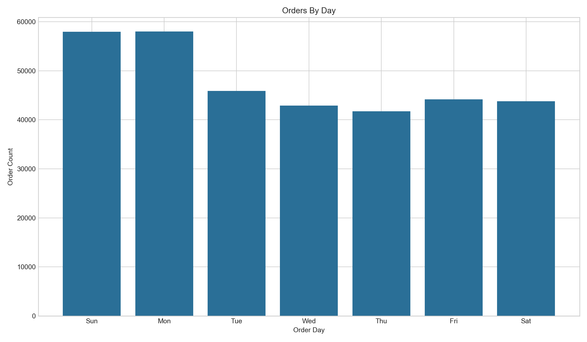

# RetailPulse

Retail analytics, recommendation, and dashboarding on Databricks. A validated Instacart implementation that runs a bronze, silver, and gold Delta pipeline, persists OLAP and report tables, mines cross-sell rules, clusters shoppers, validates a replay-style stream, and feeds a five-page AI/BI dashboard.

- [Architecture](architecture.md)
- [Setup](setup.md)
- [Results](results.md)
- [Source repository](https://github.com/The-Harsh-Vardhan/RetailPulse)

## Scope and honesty

RetailPulse proves a validated Instacart analytics implementation, not a generic upload-any-retail-CSV product. The supervised models are exploratory. A self-service upload and mapping flow is planned but not implemented.

