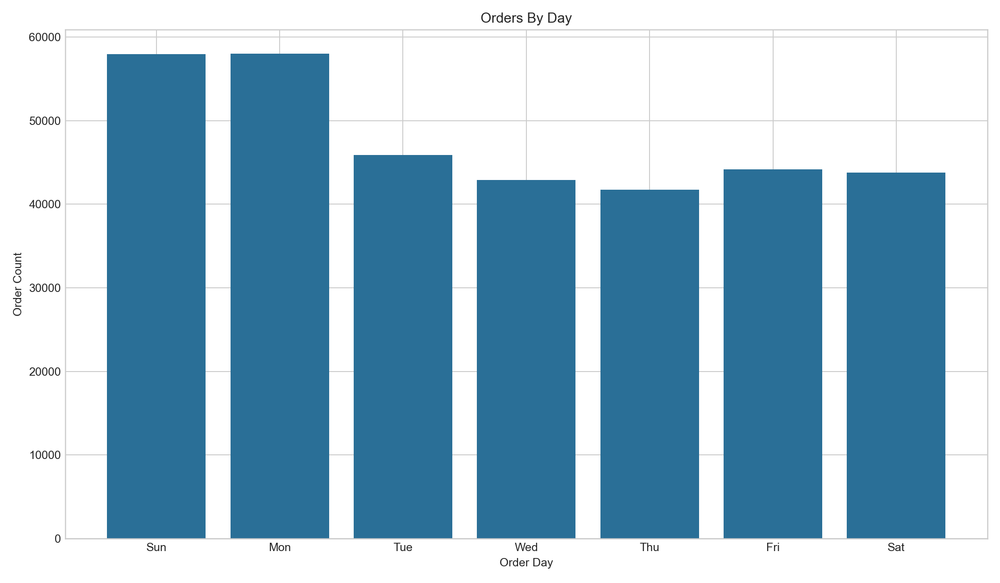
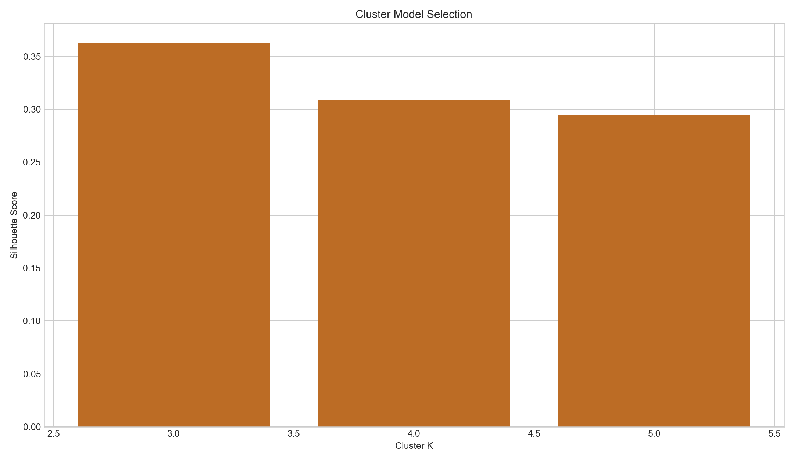
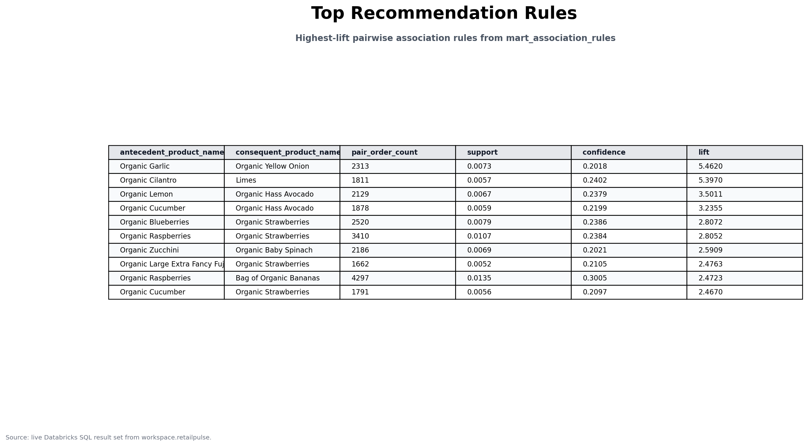
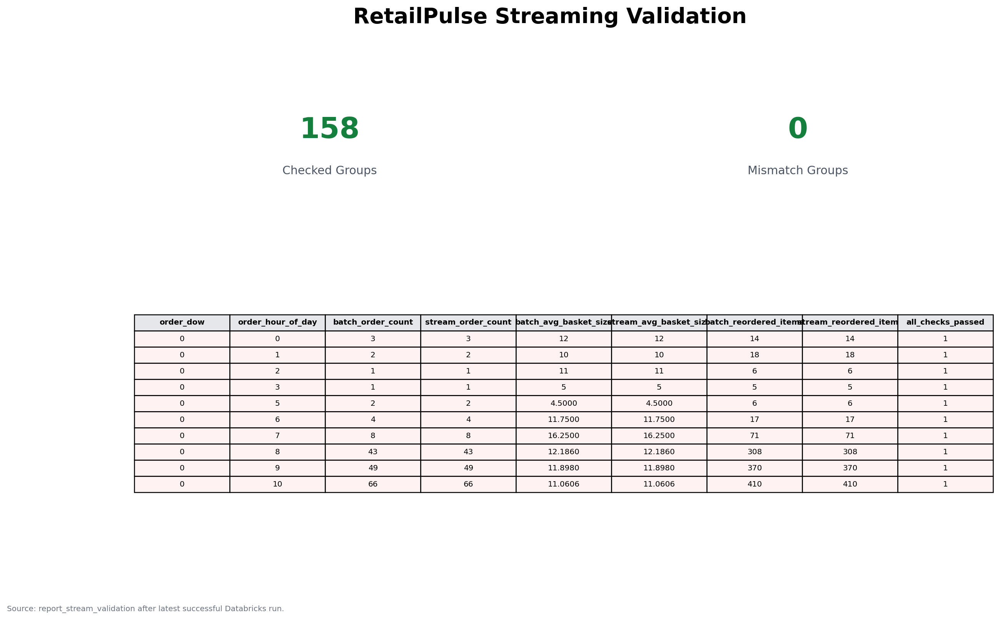
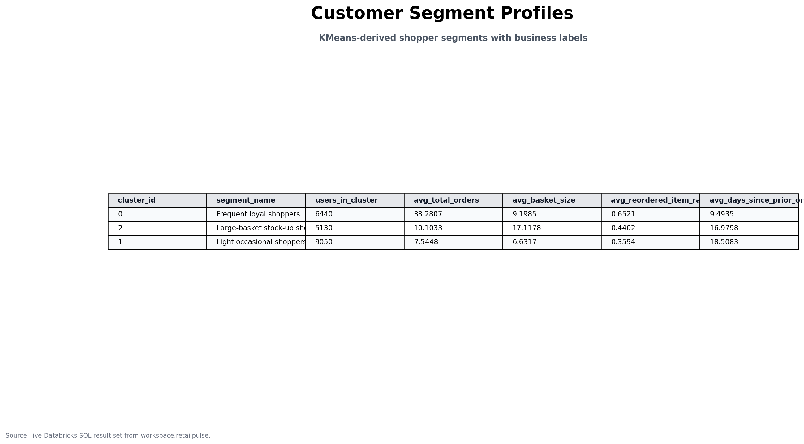

# Results

Validated on Databricks Free Edition serverless on 5 April 2026 (job `61936309152043`, run `631388168060027`). Full detail is in `RESULTS-README.md` in the repository.

| Area | Result |
| --- | --- |
| Sample size | 341,974 orders, 3,267,191 prior and 137,847 train order lines |
| Gold facts | `fact_order_items` 3,405,038 rows, `fact_orders` 334,438 rows |
| Top department | Produce, 989,427 items |
| Association rules | 49 persisted; Organic Garlic -> Organic Yellow Onion has lift 5.46 |
| Segments | 3 KMeans clusters: 6,440 / 9,050 / 5,130 users |
| Streaming check | 158 order-slot groups, 0 mismatches vs batch |
| Exploratory models | Decision tree accuracy 0.9136 vs 0.7445 majority baseline; linear regression R2 0.5580, RMSE 5.0945 vs 7.6627 mean baseline |
| OPTIMIZE / ZORDER | Completed; no speedup on this small sample |

The supervised models are exploratory and need a leakage-safe redesign before being treated as final predictive evidence.

